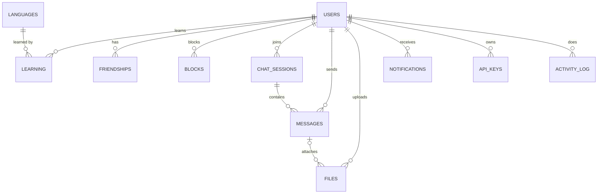

# Database schema

Status: draft for review (DB-01, #9).

Database: PostgreSQL. Refresh tokens and the matchmaking queue are stored in Redis, not here.

Legend: PK = primary key, FK = foreign key, UQ = unique, NN = not null.

## ERD

---

## users

| Column          | Type      | Constraints                | Notes                              |
|-----------------|-----------|----------------------------|------------------------------------|
| id              | integer   | PK                         |                                    |
| email           | text      | NN, UQ                     | stored lowercase                   |
| username        | text      | NN, UQ (case-insensitive)  | 3-32 chars                         |
| hashed_password | text      | NN                         |                                    |
| is_admin        | boolean   | NN, DEFAULT false          |                                    |
| role            | text      |                            | `teacher` or `student`             |
| birth_date      | date      |                            |                                    |
| gender          | text      |                            |                                    |
| bio             | text      |                            |                                    |
| avatar_file_id  | integer   | FK -> files.id             | empty = default avatar             |
| created_at      | timestamp | NN, DEFAULT now            |                                    |

Profile fields are empty until the user fills in their profile.

## languages

| Column | Type    | Constraints | Notes           |
|--------|---------|-------------|-----------------|
| id     | integer | PK          |                 |
| code   | text    | NN, UQ      | e.g. `fr`, `ar` |
| name   | text    | NN          | e.g. `French`   |

## learning

Languages a user is learning.

| Column      | Type    | Constraints            | Notes                                     |
|-------------|---------|------------------------|-------------------------------------------|
| id          | integer | PK                     |                                           |
| learner_id  | integer | FK -> users.id, NN     |                                           |
| language_id | integer | FK -> languages.id, NN |                                           |
| level       | text    | NN                     | `beginner`, `intermediate` or `advanced`  |

- `UNIQUE (learner_id, language_id)`

## friendships

Each pair is stored once, smaller user id first.

| Column       | Type      | Constraints           | Notes                  |
|--------------|-----------|-----------------------|------------------------|
| id           | integer   | PK                    |                        |
| user_low_id  | integer   | FK -> users.id, NN    |                        |
| user_high_id | integer   | FK -> users.id, NN    |                        |
| requested_by | integer   | FK -> users.id, NN    | who sent the request   |
| status       | text      | NN, DEFAULT 'pending' | `pending` or `accepted` |
| created_at   | timestamp | NN, DEFAULT now       |                        |

- `CHECK (user_low_id < user_high_id)`
- `UNIQUE (user_low_id, user_high_id)`

## blocks

| Column     | Type      | Constraints        | Notes |
|------------|-----------|--------------------|-------|
| id         | integer   | PK                 |       |
| blocker_id | integer   | FK -> users.id, NN |       |
| blocked_id | integer   | FK -> users.id, NN |       |
| created_at | timestamp | NN, DEFAULT now    |       |

- `CHECK (blocker_id <> blocked_id)`
- `UNIQUE (blocker_id, blocked_id)`

## chat_sessions

| Column     | Type      | Constraints           | Notes                                    |
|------------|-----------|-----------------------|------------------------------------------|
| id         | integer   | PK                    |                                          |
| user1_id   | integer   | FK -> users.id, NN    |                                          |
| user2_id   | integer   | FK -> users.id        | empty while waiting                      |
| status     | text      | NN, DEFAULT 'WAITING' | `WAITING`, `CONNECTED` or `DISCONNECTED` |
| started_at | timestamp | NN, DEFAULT now       |                                          |
| ended_at   | timestamp |                       | empty until the session ends             |

## messages

| Column     | Type      | Constraints                | Notes                          |
|------------|-----------|----------------------------|--------------------------------|
| id         | integer   | PK                         |                                |
| session_id | integer   | FK -> chat_sessions.id, NN |                                |
| sender_id  | integer   | FK -> users.id, NN         |                                |
| text       | text      |                            | empty for file / voice messages |
| sent_at    | timestamp | NN, DEFAULT now            |                                |

## files

The file itself is saved on disk; this table stores its details.

| Column        | Type      | Constraints           | Notes                   |
|---------------|-----------|-----------------------|-------------------------|
| id            | integer   | PK                    |                         |
| owner_id      | integer   | FK -> users.id, NN    |                         |
| message_id    | integer   | FK -> messages.id     | empty for avatars       |
| original_name | text      | NN                    |                         |
| stored_path   | text      | NN, UQ                | path on disk            |
| mime_type     | text      | NN                    | e.g. `image/png`        |
| size_bytes    | integer   | NN                    |                         |
| created_at    | timestamp | NN, DEFAULT now       |                         |

## notifications

| Column     | Type      | Constraints        | Notes                                   |
|------------|-----------|--------------------|-----------------------------------------|
| id         | integer   | PK                 |                                         |
| user_id    | integer   | FK -> users.id, NN | who receives it                         |
| type       | text      | NN                 | e.g. `friend_request`, `new_message`    |
| text       | text      | NN                 |                                         |
| is_read    | boolean   | NN, DEFAULT false  |                                         |
| created_at | timestamp | NN, DEFAULT now    |                                         |

## api_keys

Only a hash of the key is stored, never the key itself.

| Column     | Type      | Constraints        | Notes        |
|------------|-----------|--------------------|--------------|
| id         | integer   | PK                 |              |
| user_id    | integer   | FK -> users.id, NN |              |
| name       | text      | NN                 |              |
| key_hash   | text      | NN, UQ             |              |
| created_at | timestamp | NN, DEFAULT now    |              |
| revoked_at | timestamp |                    | empty = active |

## activity_log

| Column     | Type      | Constraints     | Notes                          |
|------------|-----------|-----------------|--------------------------------|
| id         | integer   | PK              |                                |
| user_id    | integer   | FK -> users.id  |                                |
| action     | text      | NN              | e.g. `login`, `chat_started`   |
| created_at | timestamp | NN, DEFAULT now |                                |

## queue_entries

Not a table: the matchmaking queue is stored in Redis (see `docs/ARCHITECTURE.md`).

---

## Indexes

| Table    | Columns                      | Used for                 |
|----------|------------------------------|--------------------------|
| users    | `role, gender, birth_date`   | partner search           |
| learning | `language_id`                | search by language       |
| messages | `session_id, sent_at`        | chat history             |

---

## Open questions

- Can `hashed_password` be empty for users who log in only with Google/GitHub?
- Does a chat session exist while waiting, or only after a match?
- Should we also store the languages a user speaks?
- When a user deletes their account, what happens to their messages and files?
